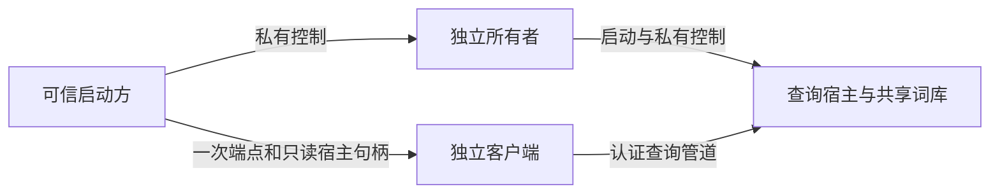

# 独立引擎所有者与可信交接

WIN-03b，2026-11-10。新增 C++ 开发程序 `harukoto_engine_owner.exe` 与 `Windows/EngineOwner.h`，把[动态引擎宿主](ENGINE_HOST.md)的启动、控制和退出监督放入独立进程。查询客户端直接连接宿主，首个客户端退出不会销毁所有者或共享词库。当前发行和本机安装仍为 Windows 0.4.4-alpha.22、FF14 0.3.0，没有安装、注册或自动启动这个程序。

已完成受控启动链、跨进程动态端点交接，以及显式部署标识下的[可选单实例竞争](ENGINE_INSTANCE.md)。普通应用仍不能自行发现或注册到所有者：分配请求来自一个可信启动方的私有单槽接口，启动方再把端点及宿主对象交给自己创建的测试客户端。正式发现与可信接手、客户端注册与认证、诊断入口、版本管理和 TSF 均未实现。不能把这个实验程序直接当成已完成的常驻服务。

## 进程与寿命



所有者只监督自己创建的一个宿主，不加载词库、不缓存候选、不转发按键或文字。每次 Allocate／Inspect 最多一个在途任务，按原操作转交宿主；回复对应外层请求的精确序号和操作。查询仍沿用原 ClientGate、候选快照和 Ticket 归属检查，不经过所有者的控制路径。端点和后台任务容量规则见[私有控制说明](ENGINE_CONTROL.md)。

可信启动方的 EngineProcess 拥有包含所有者进程树的 kill-on-close Job；所有者内部另用 EngineProcess 拥有宿主及自己的 Job。挂起创建、显式继承、加入 Job、恢复线程的顺序不变。客户端不是这条所有权链的根，可以由其他测试进程分别创建和回收。首个客户端退出后，宿主回收其端点，其他客户端的组字继续保留，同一个所有者可以申请新的随机端点。

最后一个客户端断开后宿主保持等待，生命周期由可信启动方与所有者决定。当前启动方退出或放弃自己的 EngineProcess 仍会回收整个所有者／宿主进程树；尚未实现启动方退出后脱离其 Job 的正式常驻服务。这部分须与实际登录会话、部署信任和单实例发现一起设计。

## 启动与接口

```cpp
EngineProcess::Config config{hostExecutable, base, themes, personal};
config.dynamicEndpoints = true;
config.ownerExecutable = ownerExecutable;
config.ownerInstance = L"harukoto-main"; // 可选；同一部署跨版本使用同一标识。
config.connections = 8;
EngineProcess process(config);
// 合并 waitHandles()／deadline()，poll 至 Ready，再 requestControl／takeControl。
```

`executable` 仍是查询宿主的可信绝对路径；可选 `ownerExecutable` 是独立所有者的可信绝对路径，要求开启 dynamicEndpoints，拒绝相对路径、内嵌 NUL 及与宿主相同的路径值。空 ownerExecutable 保持原直接宿主模式。源码不会搜索 PATH、查找公开 PID、从对端自报路径启动，或猜测某个已运行进程可信；测试中的固定同目录宿主路径仅用于 CTest 夹具。

ownerInstance 非空时，所有者先竞争当前登录身份下的部署占位，再启动宿主。竞争失败返回 InstanceBusy，不自动连接已有实例；宿主通过显式继承保留同一占位直到实际退出，避免所有者崩溃后的回收空档。空标识不启用竞争，范围、权限、固定句柄寿命及失败边界见[单实例说明](ENGINE_INSTANCE.md)。

管理器将基础／主题／个人路径、线程数、端点上限及可选追踪路径交给所有者，再由所有者交给宿主；不改变默认 2 线程和查询期限。所有者自身不创建追踪文件。构造、启动和句柄复制包含系统调用，所有方法仍属于服务／I/O 线程，不允许直接进入 TSF 前台回调。

`processHandle()` 在该模式返回受管理的所有者进程对象，用于外层退出监督；`engineHandle()` 返回启动时固定保留的查询宿主对象，Ready 前为空。成功 Allocate 返回的 Endpoint 使用宿主对象的非继承 query／wait 副本，不能拿所有者进程来认证查询管道。客户端只接收端点和这个受限对象，不接收所有者控制、Job、映射或 PROCESS_DUP_HANDLE 能力。

## 启动时固定宿主对象

启动方先创建一个额外的未命名 32 字节映射，通过显式继承列表交给所有者。所有者等待真实宿主 ready，复制一份 query／wait 权限且不可继承的宿主对象，将版本和该本地句柄值写入映射，然后才通知外层 ready。外层使用自己 CreateProcess 返回并保留的所有者进程对象作为 DuplicateHandle 的源进程，复制同一个宿主内核对象，并检查进程存活和当前登录身份；完成之前不会进入 Ready。没有通过数字 PID 重新 OpenProcess。

映射内的数字是私有启动链中的源句柄槽，不能从公开文件、命令行自报或注册表恢复可信性。`EngineOwnerAnchor.h` 拒绝空／未知版本、非零保留字节和非法句柄值，ready 后没有发布有效对象时外层记 ControlIo 并终止自己的进程树。路径可信性、部署目录权限、程序签名／版本及同用户恶意进程隔离不由这个映射解决。

源句柄槽在所有者进程寿命内固定保留，不在宿主退出、映射销毁或其他用户态析构时关闭，以免启动交接与关闭竞争时复制到已复用的槽。每个所有者只发布一次，只保留这一个受限对象；操作系统在所有者实际终止时回收。代码中的 `anchor.release()` 是这个明确的寿命约定，不能改成按请求创建或任意提前关闭。外层得到自己的受限副本后，不依赖源映射继续存在，也不会把源句柄数字转给普通客户端。

## 退出与失败

所有者在同一 I/O 线程合并外层 stop、私有控制、宿主进程／ready／回复事件和最近期限，不做周期轮询。先观察 stop 和实际宿主退出，再处理控制回复。启动中的 stop 不会在迟到 ready 时重新启用服务；停止后放弃未领取控制请求，向宿主发送 stop，继续观察真实退出。只有停止过程中宿主正常退出且没有先前控制失败，所有者才以 0 退出。

宿主意外退出，即使退出码为 0，也让所有者失败退出；控制通道失败则先请求宿主停止。损坏的外层请求按异常路径退出并关闭自有 Job。没有自动重启、连接重建、按键／选择重放或把旧结果转给新进程。外层仍以现有状态和固定失败类别报告所有者结果，尚无分层的用户诊断界面。

内外两层期限独立：外层沿用 Config 启动／停止和每次控制请求的期限；所有者内部使用 EngineProcess 默认的 30 秒启动、5 秒停止和 5 秒控制期限。外层期限可能先到，此时按原状态机终止自己的根 Job。停止失败或所有者崩溃时，观察根进程退出不等于所有后代已退出；需要继续等待已固定的宿主对象，才能断言词库文件保护已释放。正常所有者停止则在返回前已经观察到宿主退出。

## 验证与后续工作

- `engine_process` 增补真实故障子进程：有效／未发布交接、受限且不可继承的宿主对象、错误配置、保留槽单次发布与映射销毁后不复用、坏版本／保留字节拒绝。原启动／停止期限和继承隔离测试保留。
- `engine_owner_process`／`engine_owner_full` 使用同一临时词库夹具和真实独立所有者／宿主，另创建三个独立客户端，容量为 2。两个客户端同时输入，第一个退出后第三个接入；剩余组字不变，检查同运行代次、中文简繁、日语假名、FF14、部分选择和重复选择拒绝，以及查询对象不能终止进程。
- 独立所有者回归还覆盖容量满、带未领取控制请求的停止、所有者崩溃、请求期间的故障宿主退出、坏词库启动、启动中停止、放弃启动方 Job 和实际宿主退出后的文件保护释放。故障宿主只实现启动／控制故障契约，不读取词库。
- 原直接宿主、认证管道和静态多进程基准继续回归；基准源码身份增加 EngineOwnerAnchor.h。基准仍不经过所有者，没有测量新增进程、控制转发或动态申请的性能和内存成本。

```powershell
cmake --build .build/windows/msvc --config Release
ctest --test-dir .build/windows/msvc -C Release -R '^(engine_process|engine_owner_process|engine_owner_full)$' --output-on-failure
```

下一步在可选竞争基础上明确可信部署／登录会话下的发现与竞争失败后的可信交接、启动方交接或正式生命周期、客户端注册及只读诊断入口；再接 TSF、组字边界换代和失败回退。真实应用兼容性、混合 DPI、游戏上屏与安装升级仍按验收表单独执行。
